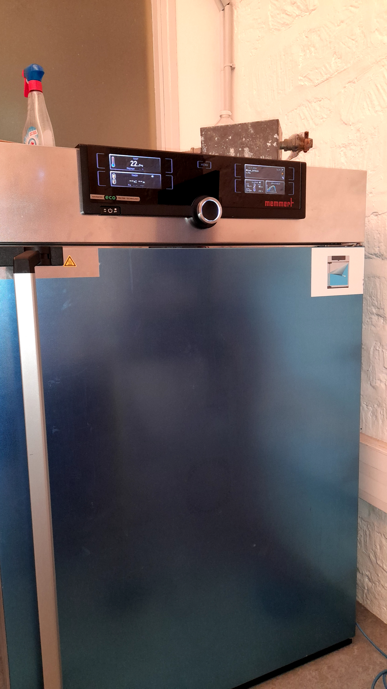
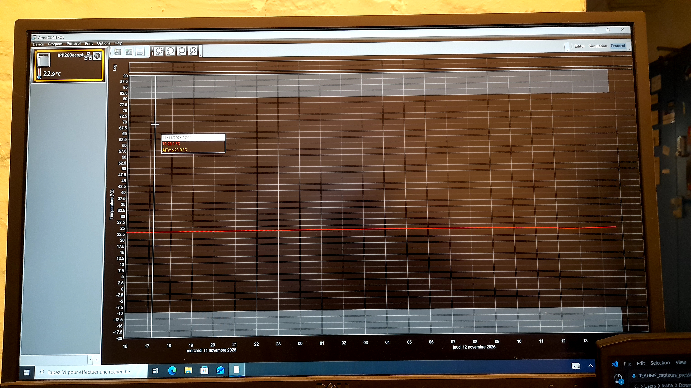
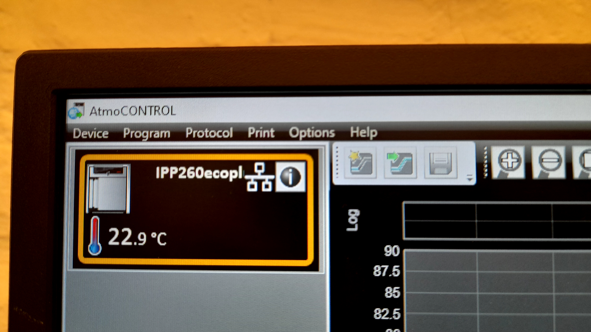
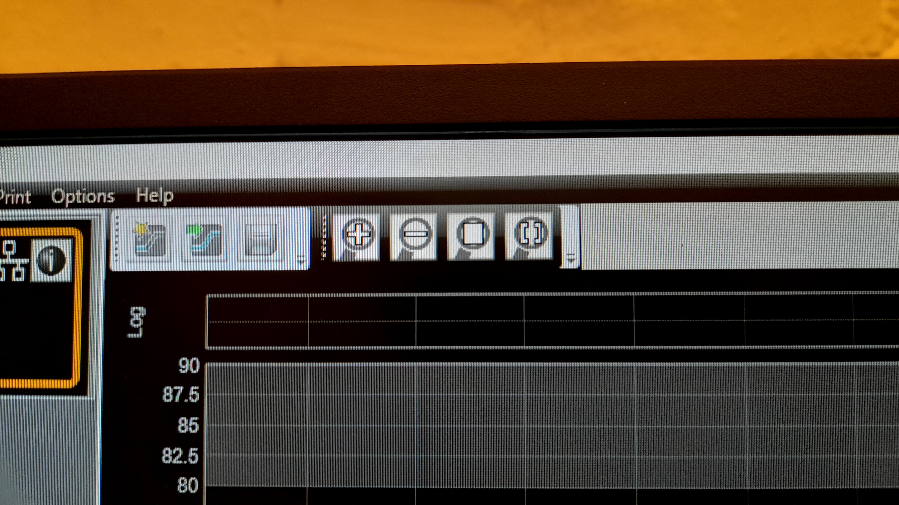
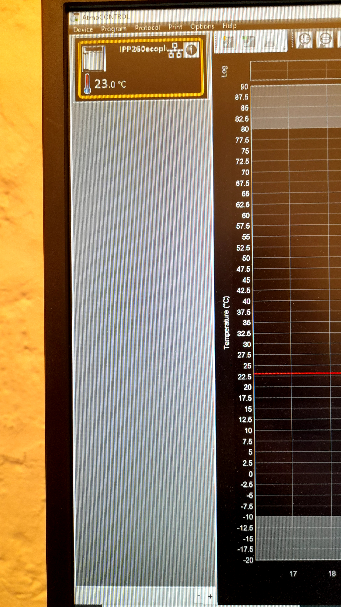
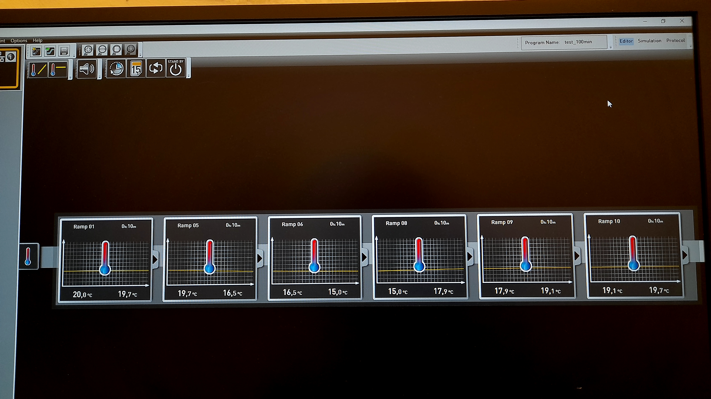
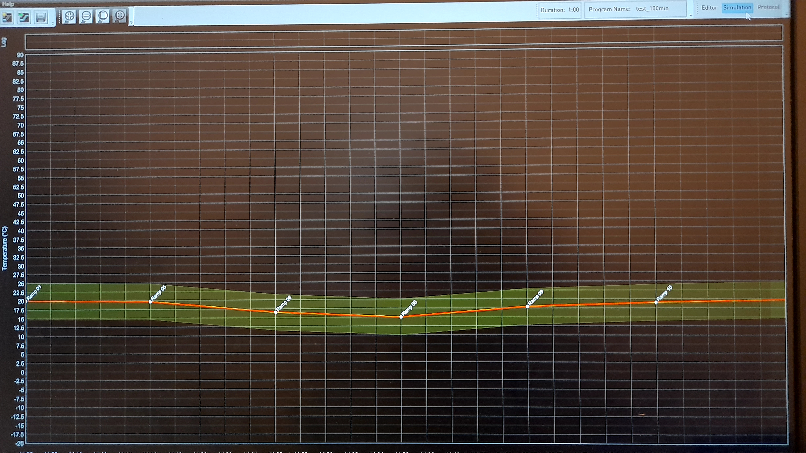
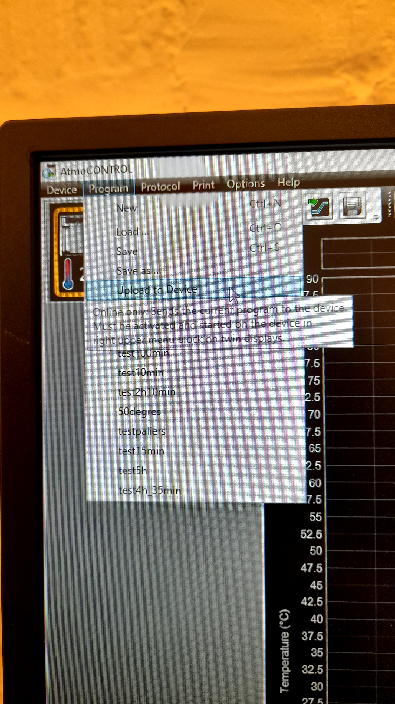

# Climate Chamber Userguide

---

## 1. Introduction
With AtmoCONTROL, you can graphically create, modify, and save programs with various parameters on the computer and transfer these programs to the climate chamber using a USB disk.

## 2. Working with AtmoCONTROL
Since we use the computer in room V003 at MINES, the following operations are based on the assumption that the AtmoCONTROL software has been installed and the AtmoCONTROL FDA device license has been successfully set up.

### 2.1 Starting AtmoCONTROL
First, unlock the computer using the username and password written on the computer tower. The AtmoCONTROL program is available on the desktop (or in the Start menu). It does not allow multiple Windows users to operate on the same computer in parallel. 

### 2.2 Program Interface

1 Menu bar 
2 Toolbar 
3 Status bar 
4 Editor, simulation and protocol window 

#### 2.2.1 Menu bar

#### 2.2.2 Toolbar

#### 2.2.3 Status bar
The status bar gives an overview of the appliances logged on to AtmoCONTROL. Appliances can be added and removed again.

If the appliance is connected to the computer via Ethernet and it has already been logged on once, it is automatically recognised and the current operating state (temperature, alarms) is displayed.

### 2.3 Program
In the Editor window, programs can be created: sequences of various parameters (e.g. temperature, pressure and humidity), which the appliance then implements from a definable point in time.

To be able to create a program in AtmoCONTROL, the appliance which is to perform the program must be listed in the status bar and selected. The appliance can, but does not have to, be connected to the computer via the network. 

Select the appliance that will later perform the program by clicking on it in the status bar. An icon bar with the available parameters for this appliance is shown. Additionally, one or two editor threads are displayed, depending on the appliance. The program sequence is determined on these. Two editor threads are always shown for appliances with humidity or pressure control (3 and 4), and one editor thread for all others.

#### 2.3.1 Create a program

**To create a program, just drag the individual parameter icons onto the editor thread one after another in the desired order**, while holding down the left mouse button. It's easy! To remove a parameter icon from an editor thread, select it and, with the mouse button depressed, move it to the recycle bin symbol on the lower right. 

Make sure that you click on the memmert chamber screen: MENU -> CONFIG -> Télécommande then choose Ecrire+Lire so that the chamber can receive the program you're preparing. 

#### 2.3.2 Parameters
To do the simulation, choose between the Temperature Ramp and the Constant Temperature and choose the corresponding duration and initial/final temperatures. You can also use the Acoustic signal, Week-timer, Calendar, Loop and Stand-by parameters if needed for your simulation and test. 

An example of program looks like this: 

Click on Simulation on the top-right corner of the screen to see the graph:

#### 2.3.3 Saving
First we have the way to transfer a program via USB. Click Program -> Export to USB drive. The program is saved on the USB storage medium connected. Then connect the USB data medium to the appliance which is to run the program.

Another way is to upload via Ethernet. Make sure the ethernet cable is connected between the climate chamber and the computer. Then after you save you file, click on Program -> Upload to Device. 

#### 2.3.4 Loading and running the program
Now, on the memmert chamber screen, go back to CONFIG -> Télécommande -> put it to Off. Then, click on MENU ->PROG -> Sélectionner and choose your program. Finally, click on MENU and start your program. 

## 3. Parameters to simulate a day
We use the function $\theta=\theta_0+\theta_\text{amp}\sin{\left(\frac{2\pi}{24\cdot3600}t\right)}$ to represent the way of daily temperature change in a region, with $a$ half of the daily temperature change and $b$ the average temperature of a day. Sadly, the AtmoControl software does not provide sinusoidal commands, so we have to approximate a sinewave with segments. Moreover, the software only allows for integer temperature inputs.

The `AtmoCONTROL_command_generation` notebook can generate ramps for any function and any number of segments. This method is optimal because it minimizes the quadratic error between the original signal and the segmentized signal. However, you need to manually set each individual ramp in the software, so a lot of points require a longer configuration time. 

