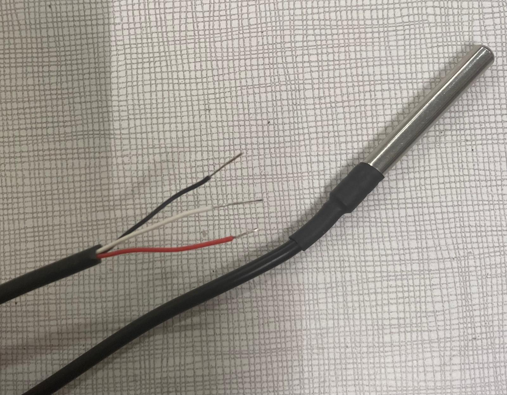

# Calibration of the temperature sensors

The temperature sensors that are used are:
- NTC HOBO TMC6-HD

They are NTC thermistors, wired in a voltage divider: the resistance of the thermistor changes with the temperature, so the voltage across the divider changes too. The sensor therefore delivers a **voltage**, and a voltage-temperature law is needed to get the temperature back.

The voltage is read by the Arduino with a 12-bit ADC (values from 0 to 4095, 3.3 V reference):

$V = \frac{ADC}{4095} \times 3.3$

## Voltage-temperature law

We fit an exponential law directly between the voltage and the temperature:

$$T = A\,e^{B\,V}$$

with $T$ in °C and $V$ in volts. The calibration gives:

$$\boxed{T = 146.133\,e^{-1.1428\,V}}$$

```python
import numpy as np

def adc_to_celsius(adc):
    v = adc / 4095 * 3.3
    return 146.133 * np.exp(-1.1428 * v)
```

## Calibration procedure

### Data

The data are in `RECORDS_corrige.xlsx`, sheet `Measurements`:

- 1116 records on 30/10/2026, from 14:40:03 to 16:12:58, one record every 5 s.
- `Last_number`: raw ADC value of the calibrated channel. `Last number normalized` is the same value converted to volts.
- `True_temperature_C`: reference temperature, decreasing from 20 °C to 16 °C over the record. (*To complete: how the reference temperature was measured and how the sensor was cooled.*)

### Least-squares fit (sheet `Sheet2`)

Taking the logarithm of the law makes it linear:

$$\ln T = a_0 + a_1 V \qquad \text{with } A = e^{a_0},\ B = a_1$$

So we run a linear regression with $X = V$ and $Y' = \ln(T)$ over the $n = 1116$ records:

$$a_1 = \frac{n\sum X Y' - \sum X \sum Y'}{n\sum X^2 - \left(\sum X\right)^2}, \qquad a_0 = \frac{\sum Y' - a_1\sum X}{n}$$

The sums are computed in the spreadsheet (columns `Y'`, `XY'` and `X^2`). Result:

| Parameter | Value |
|---|---|
| $a_1 = B$ | −1.1428 |
| $a_0$ | 4.9845 |
| $A = e^{a_0}$ | 146.133 |

### Check

For each record, the sheet computes the temperature given by the law, the difference with the reference temperature and the squared difference. The mean squared difference is 0.598 °C², which is a root-mean-square error of about **0.77 °C**. The bias is close to zero.

## Validity and limits

- **Accuracy:** the largest errors are at the beginning of the record (about 3 °C in the first rows, RMS error of about 1.7 °C over the first 100 records). This is probably the thermal lag of the sensor, which has not yet reached the reference temperature. Afterwards the RMS error is about 0.6 °C.
- **Fit on ln(T):** the regression minimizes the error on $\ln T$, not on $T$, so this is not exactly the least-squares exponential on $T$. The difference is small over such a narrow range.

### Here is an image of the temperature sensor. 



3D printing files and instructions for the thermometer/pressure shaft are available in the "shaft" folder.
